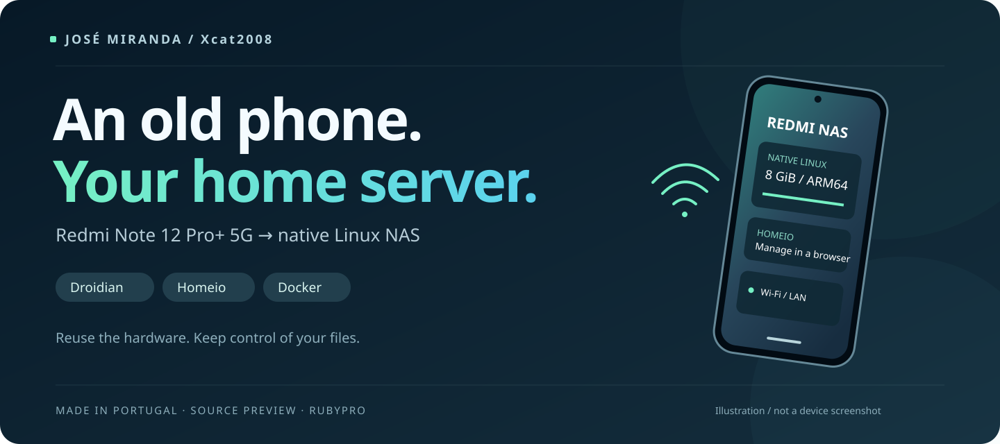

# Redmi Note 12 Pro+ NAS

🇵🇹 **Made in Portugal — a project by Portuguese developer José Miranda (Xcat2008).**

**A retired phone, a native Linux system, and a home server you can manage from a browser.**

Project by **José Miranda (Xcat2008)** · GitHub: [Xcat2008](https://github.com/Xcat2008)

[Quick start](docs/QUICKSTART.md) · [Português](README.pt-PT.md) · [Porting guide](docs/INSTALLATION.md) · [Tested hardware](docs/COMPATIBILITY.md) · [Credits](CREDITS.md)

This project documents a working NAS experiment on a **Xiaomi Redmi Note 12 Pro+ 5G (22101316UG / rubypro)** with a MediaTek Dimensity 1080, 8 GiB of physical RAM and 256 GB of internal storage. Android userspace was replaced with **Droidian / Debian**, using the device's vendor kernel and Halium compatibility stack. **Homeio** provides the web desktop and application management; Docker runs applications on ARM64.

The phone keeps a normal Phosh desktop. Homeio runs in the background and starts automatically; the display can switch off while the NAS remains available over Wi-Fi.

## Release status

**Developer preview. NAS setup has an automated entry point for an already booting native Droidian port. Replacing Android with Linux is still a manual porting stage; there is no public flashable image.**

The original device has been tested, but the public procedure has not yet been repeated on a second clean phone. Some setup stages still need a porter familiar with Android boot images, Halium and Linux storage. Read the [installation guide](docs/INSTALLATION.md) before deciding to replicate it.

| Capability | Result on the project device |
| --- | --- |
| Native Linux boot and systemd | Working |
| Wi-Fi and automatic reconnect | Working |
| Homeio browser desktop | Working |
| Automatic NAS startup after reboot | Working |
| NAS stays available with display off | Working after the mobile-power-saver fix |
| Docker ARM64 container | Working |
| Jellyfin | ARM64 container and web interface working with persistent Raspberry Pi device-mapping compatibility; media playback still to be tested |
| Physical power and volume buttons | Working with the documented adaptations |
| CPU / GPU / RAM reporting | ARM hardware reporting patch included |
| USB hub, simultaneous charging and external disks | Not yet tested |
| Bluetooth, SIM / mobile data and cameras | Not validated; Bluetooth currently reports a missing rfkill device |
| Jellyfin hardware transcoding | Not validated |

## What is included

- The kernel configuration used for the native Linux NAS.
- Source revisions and compatibility patches for the connectivity modules.
- The display wake bridge and NAS power-policy setup.
- Homeio ARM hardware-reporting changes, with fixture tests.
- The Jellyfin compatibility fix and a portable compose example.
- Installation, recovery, validation and licensing notes.

The custom 3D enclosure is a separate personal build and is not included here. Firmware blobs, factory images, personal data, device credentials and configured root filesystems are not distributed.

## Start here

1. Read the [quick start](docs/QUICKSTART.md), then check the exact model and [compatibility matrix](docs/COMPATIBILITY.md).
2. Read the [installation and recovery notes](docs/INSTALLATION.md).
3. Use the [pinned source manifest](sources.lock.json) and build notes; do not flash an image intended for a different Redmi model.
4. On an already working native Droidian installation, use the scripts in `scripts/` after reviewing them.
5. Follow [validation](docs/VALIDATION.md), including a display-off test, before relying on it as a NAS.

This is an independent community experiment, not an official Xiaomi, Droidian or Homeio device release. We do not claim that using a phone as a Linux server is new or that this is the first such project worldwide.

## Support the project

Donation links are temporarily disabled while the author verifies the payment setup. No payment recipient is configured in this preview. Voluntary contributions will support José Miranda's work on this project. They do not purchase support or imply an endorsement from the upstream projects. Please also consider supporting those projects directly; see [credits](CREDITS.md).

Contributions, reproducible bug reports and documentation improvements are welcome. Read [CONTRIBUTING.md](CONTRIBUTING.md) and [SECURITY.md](SECURITY.md) before posting logs.

## License

Original project scripts and documentation are licensed under **AGPL-3.0-only**, except where an individual file states otherwise. Kernel configuration and kernel/module patches retain **GPL-2.0-only** compatibility and upstream notices. Homeio-derived code remains **AGPL-3.0-only**. See [LICENSE.md](LICENSE.md) and [THIRD_PARTY_NOTICES.md](THIRD_PARTY_NOTICES.md).
