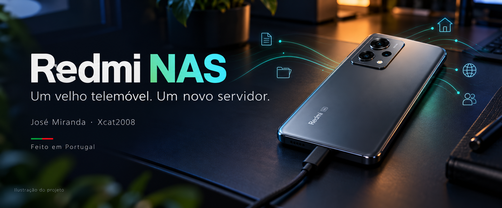
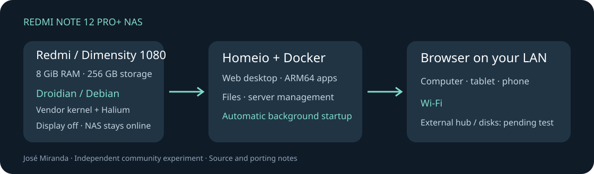
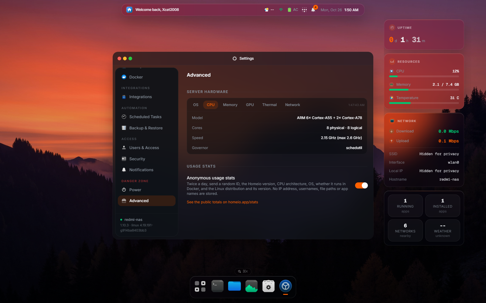
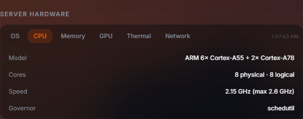
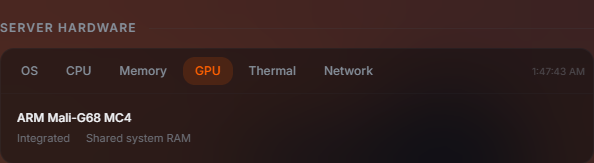
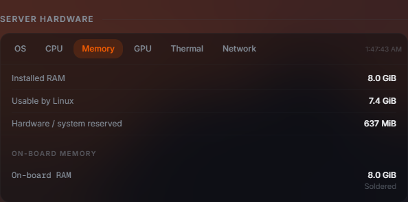
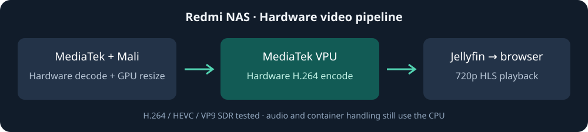

*Ilustração de capa do projeto. As capturas abaixo mostram o aparelho real em funcionamento.*

# NAS num Redmi Note 12 Pro+ 5G

🇵🇹 **Projeto português, desenvolvido em Portugal por José Miranda (Xcat2008).**

Transformar um telemóvel antigo num servidor doméstico: **Droidian / Debian nativo**, Wi-Fi, armazenamento interno e **Homeio** como ambiente de trabalho acessível pelo browser. O Homeio funciona em segundo plano; o ecrã do telefone pode ficar apagado sem parar a NAS.

## O painel a funcionar no Redmi

Capturas reais do Homeio, feitas em 26 de outubro de 2026. O servidor está no telemóvel, com Linux nativo e ligação por Wi-Fi.

| Processador: oito núcleos | GPU integrada |
| --- | --- |
|  |  |

Memória e notas das capturas

O aparelho tem 8 GiB de RAM física; o Linux apresenta cerca de 7,4 GiB após as reservas da plataforma. Os valores de utilização variam. A descodificação e a codificação de vídeo MediaTek, com redimensionamento na gráfica Mali, já foram testadas no leitor web do Jellyfin. Os identificadores da rede foram ocultados e o atalho do Jellyfin foi retirado apenas das capturas. [Notas das imagens](docs/SCREENSHOTS.md).

## Estado desta publicação

Esta é uma **prévia técnica com código-fonte, configurações e notas de instalação**. A NAS funciona no aparelho do projeto. Também foi construída uma imagem limpa de arranque e dados, com um instalador para Windows, mas falta testar essa instalação completa num aparelho limpo antes de disponibilizar os binários ao público. Consulta o [estado do instalador](docs/IMAGE-INSTALLER.md).

O aparelho usado é o **Redmi Note 12 Pro+ 5G, modelo 22101316UG (rubypro)**, com Dimensity 1080, 8 GiB de RAM física e 256 GB de armazenamento. Não usar imagens do modelo 4G ou de outro telemóvel.

Confirmámos Linux nativo, Wi-Fi, Homeio, Docker ARM64, arranque automático e funcionamento da NAS com o ecrã apagado. O Jellyfin reproduz no browser e converte 1080p para 720p usando descodificação MediaTek, redimensionamento Mali e codificação H.264 MediaTek. O Bluetooth pode ser gerido em **Settings → Bluetooth**, no Homeio: ligar/desligar, procurar, emparelhar, ligar, desligar e esquecer dispositivos. A pesquisa e os controlos do rádio foram testados no browser; falta testar o emparelhamento com um comando físico. [Como usar](docs/BLUETOOTH.md). Hub, carregamento simultâneo com USB e discos externos ainda não foram ensaiados; SIM e câmaras não estão validados.

## Vídeo por hardware

Os perfis de energia estão em **Settings → Performance**: Poupança, Equilibrado e Desempenho. O modo recomendado é **Equilibrado**, com frequência ajustada à carga. Foi corrigido o gestor que voltava a limitar o CPU; os testes confirmaram os limites de fábrica do processador, a subida automática da Mali e a resposta do controlador de memória. O overclock aparece como não validado e não permite alterar tensões. [Detalhes e medições](docs/ENERGY.md).

A ponte de vídeo utiliza os serviços multimédia do Android que o Droidian já inclui. Foram testados H.264, HEVC e VP9 SDR, saída H.264, reprodução no browser e procura dentro do filme. O áudio, o empacotamento HLS e outros serviços continuam a usar CPU. HDR, legendas gravadas na imagem e outros formatos não ficam certificados por estes testes. Esta integração também não acelera automaticamente todas as aplicações.

A imagem limpa candidata já inclui o adaptador compilado, o código e o perfil automático do Jellyfin. A instalação de raiz dessa imagem num aparelho limpo continua por validar. [Detalhes e testes](docs/MEDIATEK-VIDEO.md).

## Como começar

1. Começar pelo [guia rápido](docs/QUICKSTART.md) e ler o [guia de instalação e recuperação](docs/INSTALLATION.md).
2. Confirmar a [compatibilidade do hardware](docs/COMPATIBILITY.md).
3. Consultar as [fontes e versões](sources.lock.json).
4. Depois de o Linux arrancar, aplicar as adaptações de energia, ecrã e Homeio.
5. Fazer os [testes de validação](docs/VALIDATION.md), incluindo ecrã apagado e reinício.

O desbloqueio do bootloader foi feito através do processo oficial da Xiaomi. Esse desbloqueio apaga os dados. A preparação do armazenamento Linux também exige apagar a partição de dados; a cópia de segurança e um plano de recuperação devem estar prontos antes de alterar o aparelho.

A caixa 3D é um projeto pessoal separado e não faz parte deste repositório. Também não são publicados dados pessoais, palavras-passe, chaves SSH, firmware proprietário ou uma cópia do sistema já configurado.

## Donativos e agradecimentos

O perfil GitHub Sponsors do autor aguarda aprovação. O link de apoio será acrescentado quando estiver ativo.

O trabalho usa software criado por várias comunidades. Os agradecimentos e respetivos links estão em [CREDITS.md](CREDITS.md), em especial **Droidian, Debian, Halium, libhybris, Linux e Homeio**. A autoria deste projeto é a integração e adaptação feita por José Miranda; não é a autoria desses sistemas.

[Documentação principal em inglês](README.md) · [Licenças](LICENSE.md)
