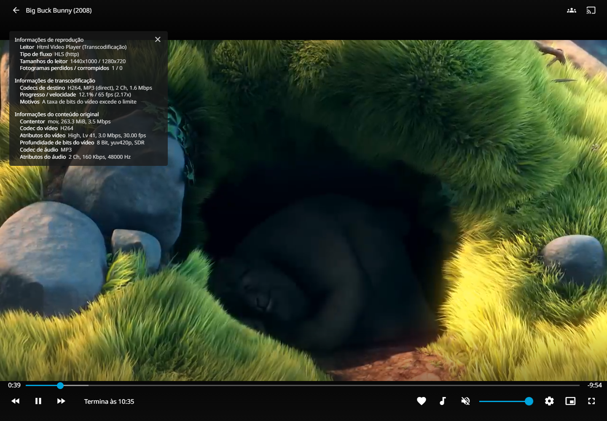

# H.264 hardware encoding on the Redmi NAS

The supported port now uses the **MediaTek VPU** to encode H.264 in Jellyfin. This is the video codec engine in the Dimensity 1080; the Mali-G68 GPU handles graphics separately. Success here does not automatically accelerate every application.

## What changed

The vendor `mtk-vcodec-enc` driver expects ION-backed DMA-BUF memory. Standard FFmpeg V4L2 MMAP queues did not supply the buffer handles expected by that driver. The small [adapter](../apps/jellyfin/mediatek/mediatek-dmabuf-bridge.c) translates the queue memory operations and allocates compatible ION buffers. Jellyfin still selects its native `h264_v4l2m2m` encoder; the adapter does not substitute a software encoder or alter reported playback statistics.

The preload wrapper is scoped to Jellyfin's FFmpeg process. It is not a system-wide preload. The container receives three explicit device mappings and read-only adapter mounts, without privileged mode. The installed adapter needs access to the codec nodes and ION allocator; use it only with the pinned kernel and tested ARM64 container version.

## Automatic installation and persistence

The [NAS installer](../scripts/install-nas.sh) compiles and installs the adapter before building Homeio. The clean image candidate also contains a precompiled ARM64 copy, its source and the profile marker. Homeio applies the configuration when materializing a Jellyfin store installation:

- Pin the tested LinuxServer Jellyfin image and set the FFmpeg wrapper path.
- Map `/dev/video1`, `/dev/video2` and `/dev/ion`; let LinuxServer initialize device permissions.
- Mount the adapter and first-run initializer read-only.
- Set H.264 hardware encoding in `encoding.xml` once. Existing settings are backed up; later user choices are preserved.

Application accounts and libraries are created by the user. No account, API key, media file or Wi-Fi configuration from the development phone is baked into the image. The clean image's complete physical installation remains pending; this does not change the tested results on the running device.

## Validation on 26 October 2026

| Test | Result |
| --- | --- |
| Native encoder output | Synthetic sample and 450-frame real-video sample verified independently |
| Empty Jellyfin configuration | Healthy startup, first-run setup still incomplete, settings writable by the service user, native H.264 encoding passed |
| Homeio catalog reinstall | Uninstall/install without removing data; adapter mounts, device access and encoding profile restored automatically |
| Real Jellyfin browser playback after reinstall | 1080p input → 1280 × 720 H.264 HLS, requested 1.5 Mb/s quality; `h264_v4l2m2m` on `/dev/video2` |
| Encoder speed | Approximately 60–65 frames/s in the measured 30 fps video sample |
| Restart | Container restarted and playback verified again |

The screenshot shows the actual playback panel at 65 encoding frames/s. The measured browser samples counted 0 dropped frames out of 789 before the container restart check, and 1 out of 786 after the catalog reinstall. The movie frame is from the credited CC BY film below.

Jellyfin reported `HardwareAccelerationType=v4l2m2m` and `IsVideoDirect=false`. FFmpeg confirmed `h264 (native) → h264 (h264_v4l2m2m)` and DMA-BUF queues. Sampled container CPU consumption was about three cores, compared with about seven for the earlier software-encoding reference. These are observations for one clip and device, not a benchmark of all media or concurrent clients.

The test video was *Big Buck Bunny*, Blender Foundation / www.bigbuckbunny.org, 2008, with the 2013 Sunflower version by Janus Bager Kristensen, licensed [CC BY 3.0](https://creativecommons.org/licenses/by/3.0/). [Original test download](https://download.blender.org/demo/movies/BBB/bbb_sunflower_1080p_30fps_normal.mp4.zip). The film is not included in the project image.

## Limits

**Decoding and resizing still run on the CPU.** Hardware H.264 encoding is verified; hardware H.265 encoding, hardware decoding, HDR tone mapping and other formats are not. Direct play remains preferable when the client accepts the original file. Do not select NVIDIA, VA-API or another unrelated backend for this phone.

The standalone software-mode compose example remains available as a fallback. Before changing the pinned Jellyfin/FFmpeg image or kernel, repeat the empty-config, real playback and reinstall checks.
