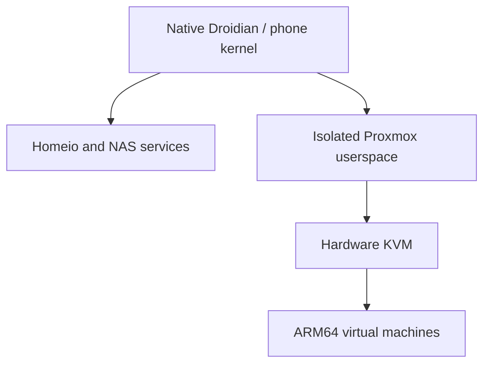

# Virtual machines on the Redmi NAS

On 29 October 2026, the project device booted a full Debian 13 ARM64 VM under Proxmox VE 9.2.20 with hardware KVM. Eight guest workers were exercised on the eight physical CPUs, with calculation integrity, disk persistence, networking and guest restart checks.

This is an experimental device profile. It is separate from the previously assembled NAS image candidate.

## What is available now

| Location | Current state |
| --- | --- |
| Configured project phone | Proxmox installed, Homeio shortcut available, eight CPUs usable by VMs |
| This repository | Compatibility source, a guarded updater for an existing environment, kernel configuration fragment and validation notes |
| Existing clean image candidate | Does not contain the KVM platform changes or this Proxmox profile |
| Public automatic fresh Proxmox install | Not released; the platform activation and clean installation procedure still need validation |

The intended distribution is an **optional virtual-machine component** on a compatible KVM platform. A NAS-only installation should not have to run the Proxmox daemons. This is a distribution plan, not an App Store entry that already exists. No normal NAS installer or first-boot default has been changed by this source update.

## How it is arranged

The isolated Proxmox root is on the phone's data filesystem. Its QEMU and PVE packages are kept separate from the host LXC used by Droidian's Android hardware services. A generic Proxmox/Debian kernel must not replace the device kernel. Package restrictions in the configured profile prevent that accidental installation.

The current budget is eight shared physical CPUs, a 3 GiB RAM ceiling and a 1 GiB swap ceiling for the whole Proxmox environment. These are configured limits, not a claim that the phone has only 3 GiB of RAM. The NAS can still use all physical CPUs. The six A55s and two A78s have different performance; eight available cores do not mean eight A78s. Thermal protection and factory clock limits stay active.

Guest network `vmbr0` uses private DHCP/DNS and NAT. It provides outbound access without adding a DHCP server to the home LAN. It does not give every VM an address on the home LAN automatically. The local VM store uses internal phone storage; guests and NAS files share its capacity.

## Why the compatibility changes are needed

### Mixed CPU clusters

The kernel's legacy `get_ccsidr()` reads the cache geometry of the physical CPU making the call. The A55 and A78 values differ. QEMU can read a value on one cluster and later receive `EINVAL` when restoring it on the other cluster. This was reproduced for three cache-description register IDs, without running a guest.

The adapter briefly pins **only** `KVM_GET_ONE_REG` / `KVM_SET_ONE_REG` calls for that cache-description group to an A78. It forwards the kernel's real values and errors, then restores the original thread affinity. It does not bypass register validation, alter instruction-set features, change clocks or pin normal guest execution to two cores. It is loaded by the isolated QEMU launcher, not through a global preload file.

Upstream KVM normalized the virtual cache geometry in the [Linux 6.3 changes](https://lists.infradead.org/pipermail/linux-arm-kernel/2023-February/812626.html). The published adapter is a userspace compatibility measure for this existing 4.19 kernel, not that kernel backport.

### UEFI startup

The current EDK2 early identity-map entry stalls on this KVM implementation. The guarded helper changes one SEC branch to use the existing later RAM page-table setup. The vendor code image remains preserved by a package diversion. The VM's EFI variable disk, the phone's boot firmware and the rest of EDK2 are not replaced by this helper.

The public updater accepts only the tested vendor code digest and recognized instruction layout. A new, unreviewed firmware package is rejected before this updater changes anything. After an APT update, the hook reports an unsupported version explicitly; a reviewed helper/digest update is then needed. This source preview does not claim compatibility with every future firmware build.

### Old-kernel disk and metrics support

The disk wrapper selects PVE's normal alternative when `io_uring` is unavailable. CPU reporting describes the physical mixture accurately; a missing CPU-full PSI counter uses PVE's unavailable-counter fallback. LXCFS provides cgroup-scoped memory, CPU, load and uptime views inside the environment. Host `/proc` remains unchanged.

## Installation boundary

1. Start with the exact device and a working native Linux NAS. See [installation](INSTALLATION.md).
2. The boot chain must actually provide EL2, and a matching device kernel plus matching hardware modules must expose working KVM. The [configuration fragment](../kernel/kvm/experimental.config.fragment) alone cannot do this. The device test involved platform boot-metadata changes that are **not** performed by the normal NAS installer or the public maintenance updater.
3. Build the isolated Proxmox userspace, its private network and scoped metrics without replacing the host LXC. This bootstrap is not yet packaged as a public unattended installer.
4. On that existing environment, use the [guarded compatibility updater](../apps/proxmox/README.md). Its preflight rejects a normal non-KVM NAS and an invocation on the NAS host.
5. Create credentials for that installation. Use the Linux PAM realm for an account created inside the Proxmox environment. No project password, account database, SSH key or configured VM is provided.
6. Repeat the guest validation before relying on the profile.

On the configured system the Homeio shortcut opens the Proxmox web interface on port 8006. On another installation, use that system's own host address. The node's Reboot/Shutdown controls apply to the isolated Proxmox environment. A full phone restart is a different operation and has not been revalidated with this experimental kernel/profile.

## Guest setup and validation

Use an **ARM64/aarch64** guest image, CPU `host`, UEFI/OVMF, a persistent EFI variables disk and a VirtIO/SCSI disk. `vmbr0` is the tested private bridge. The headless Debian cloud image uses `serial0` as its default console; its inactive graphical framebuffer is not a desktop. For cloud-init, choose credentials specific to that VM. Memory allocated to VMs must leave room for the PVE services within the environment's RAM budget.

The device tests covered:

- Nine initialization trials using 1, 4 and 8 vCPUs.
- An eight-vCPU Linux smoke guest with memory/network checks and clean poweroff.
- A Debian 13 VM with eight vCPUs, 1 GiB RAM and an 8 GiB virtual disk.
- Two eight-second loads with integrity-checked calculation on all eight physical CPUs. Per-thread CPU counters confirmed execution, and temporary test affinities were restored afterwards.
- Disk write/readback and persistence through VM and Proxmox-environment restarts.
- DHCP, DNS, HTTPS access, cloud-init and the QEMU guest agent.
- Serial web-console authentication and a real guest login prompt through the NAS proxy.
- Reinstallation of the QEMU and EDK2 packages with compatibility hooks preserved/reapplied.

These are short functional tests, not long-duration stress certification. [Sanitized validation data](../apps/proxmox/validation.json) contains no private addresses, boot identifiers, credentials, user media or virtual disks.

Fresh installation, a full phone reboot of this profile, nested PVE LXC, Windows ARM, GPU passthrough, HA and Ceph are not certified. x86 Windows/Linux cannot use ARM KVM as native hardware virtualization. No automatic backup job is enabled by this source package.

## Before a KVM image release

The next image profile must be assembled from a clean base, carry these sources and matching modules, provision each installation's own credentials, and pass a supervised physical install and full reboot with recovery available. The boot-metadata activation needs its own device/layout checks and recovery validation. Redistribution/corresponding-source checks must also be completed. Until then, the existing image manifest stays unapproved and unchanged.

## Português

No telemóvel do projeto, o Proxmox já está instalado e utiliza os oito núcleos. No GitHub estão as correções e os resultados técnicos, mas **a imagem candidata anterior ainda não inclui este perfil**. Descarregar o repositório não transforma essa imagem numa instalação KVM pronta.

A proposta de distribuição é deixar o Proxmox como componente opcional numa plataforma KVM compatível. A entrada na loja e a instalação automática de raiz ainda não estão implementadas. O atualizador publicado destina-se apenas a um Proxmox isolado que já funciona; por defeito, verifica sem instalar. Não altera o arranque do telefone e não copia as contas do autor.

Antes de anunciar uma imagem com Proxmox, falta reconstruir e validar a instalação limpa, a ativação do EL2 e o reinício completo do aparelho. Os testes de VMs, disco, rede, consola e utilização dos oito CPUs já passaram no telefone do projeto.
