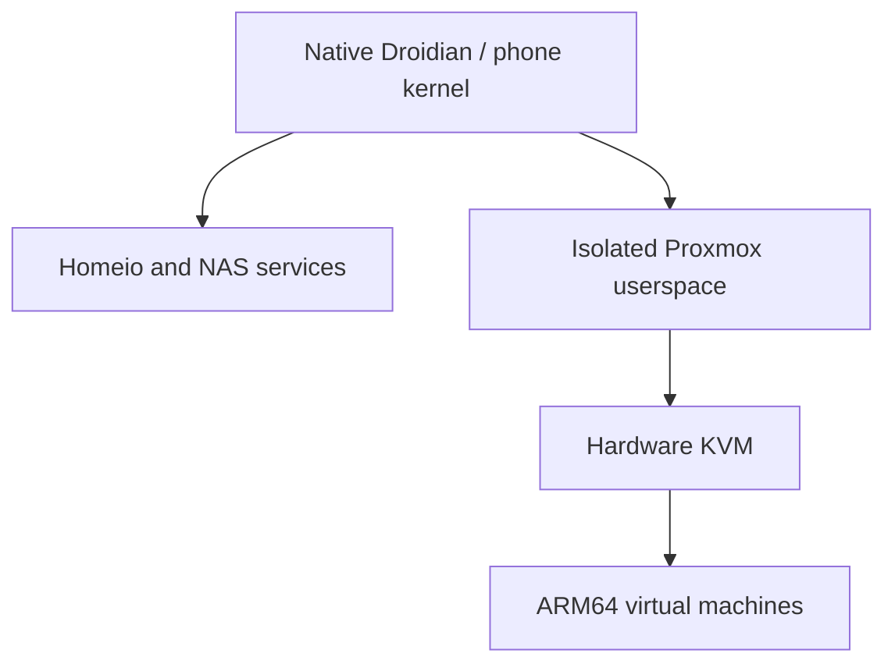

# Virtual machines on the Redmi NAS

On 29 October 2026, the project device booted a full Debian 13 ARM64 VM under Proxmox VE 9.2.20 with hardware KVM. Eight guest workers were exercised on the eight physical CPUs, with calculation integrity, disk persistence, networking and guest restart checks.

This is an experimental device profile. It is separate from the previously assembled NAS image candidate.

## What is available now

| Location | Current state |
| --- | --- |
| Configured project phone | Proxmox installed, Homeio shortcut available, eight CPUs usable by VMs |
| This repository | Compatibility source, a guarded updater for an existing environment, kernel configuration fragment and validation notes |
| Previous 0.1.0-rc7 candidate | Does not contain the KVM platform changes or this Proxmox profile |
| Private 0.2.0-rc2 validation build | Clean packages and matching KVM kernel/modules included, optional service disabled, no author accounts or VMs. Optional activation and an eight-vCPU smoke guest passed after reinstalling the project phone. Stock-device EL2 activation is still unvalidated. |
| Public automatic fresh Proxmox install | Not released; stock-device EL2 activation and binary redistribution review remain incomplete |

The intended distribution is an **optional virtual-machine component** on a compatible KVM platform. A NAS-only installation should not have to run the Proxmox daemons. This is not an App Store entry that already exists. The image setup now accepts the exact tested KVM kernel and installs the isolated-environment prerequisites; the optional PVE service remains disabled until explicitly configured on a working KVM platform. Automatic personal backups remain off.

## How it is arranged

The isolated Proxmox root is on the phone's data filesystem. Its QEMU and PVE packages are kept separate from the host LXC used by Droidian's Android hardware services. A generic Proxmox/Debian kernel must not replace the device kernel. Package restrictions in the configured profile prevent that accidental installation.

The current profile shares the eight physical CPUs and the host's available RAM with the NAS. The earlier 3 GiB RAM and 1 GiB swap container ceilings have been removed; this does not reserve all RAM for Proxmox or duplicate it. VM allocations must leave room for Linux, Homeio and other applications. The six A55s and two A78s have different performance; eight available cores do not mean eight A78s. Thermal protection and factory clock limits stay active.

Guest network `vmbr0` uses private DHCP/DNS and NAT. It provides outbound access without adding a DHCP server to the home LAN. It does not give every VM an address on the home LAN automatically. The local VM store uses internal phone storage; guests and NAS files share its capacity.

## Why the compatibility changes are needed

### Mixed CPU clusters

The kernel's legacy `get_ccsidr()` reads the cache geometry of the physical CPU making the call. The A55 and A78 values differ. QEMU can read a value on one cluster and later receive `EINVAL` when restoring it on the other cluster. This was reproduced for three cache-description register IDs, without running a guest.

The adapter briefly pins **only** `KVM_GET_ONE_REG` / `KVM_SET_ONE_REG` calls for that cache-description group to an A78. It forwards the kernel's real values and errors, then restores the original thread affinity. It does not bypass register validation, alter instruction-set features, change clocks or pin normal guest execution to two cores. It is loaded by the isolated QEMU launcher, not through a global preload file.

Upstream KVM normalized the virtual cache geometry in the [Linux 6.3 changes](https://lists.infradead.org/pipermail/linux-arm-kernel/2023-February/812626.html). The published adapter is a userspace compatibility measure for this existing 4.19 kernel, not that kernel backport.

### UEFI startup

The current EDK2 early identity-map entry stalls on this KVM implementation. The guarded helper changes one SEC branch to use the existing later RAM page-table setup. Both normal and Secure Boot code variants need this correction; each original package file remains preserved by a package diversion. The Secure Boot variant was compared with its unmodified version in a diskless KVM test, and graphical UEFI output was then verified in Proxmox. This does not establish Windows guest compatibility. The VM's EFI variable disk, the phone's boot firmware and the rest of EDK2 are not replaced by this helper.

The public updater accepts only the tested vendor code digests and recognized instruction layout. It validates both variants before replacing either runtime file. A new, unreviewed firmware package is rejected before this updater changes anything. After an APT update, the hook reports an unsupported version explicitly; a reviewed helper/digest update is then needed. This source preview does not claim compatibility with every future firmware build.

### Old-kernel disk and metrics support

The disk wrapper selects PVE's normal alternative when `io_uring` is unavailable. CPU reporting describes the physical mixture accurately; a missing CPU-full PSI counter uses PVE's unavailable-counter fallback. LXCFS provides cgroup-scoped memory, CPU, load and uptime views inside the environment. Host `/proc` remains unchanged.

## Installation boundary

1. Start with the exact device and a working native Linux NAS. See [installation](INSTALLATION.md).
2. The boot chain must actually provide EL2, and a matching device kernel plus matching hardware modules must expose working KVM. The [configuration fragment](../kernel/kvm/experimental.config.fragment) alone cannot do this. The device test involved platform boot-metadata changes that are **not** performed by the normal NAS installer or the public maintenance updater.
3. In the forthcoming image, open **Homeio Settings → Performance → Virtual machines · Proxmox**. The optional setup checks the actual KVM capability before enabling the clean isolated userspace, private network and scoped metrics. It does not replace the host LXC or activate EL2.
4. On that existing environment, use the [guarded compatibility updater](../apps/proxmox/README.md). Its preflight rejects a normal non-KVM NAS and an invocation on the NAS host.
5. Create credentials for that installation. Use the Linux PAM realm for an account created inside the Proxmox environment. No project password, account database, SSH key or configured VM is provided.
6. Repeat the guest validation before relying on the profile.

Choose a new Proxmox password of at least eight characters in that setup card; no shared default is supplied. After setup, **Open Proxmox** opens HTTPS port 8006 on the current NAS host. Log in as `root`, realm **Linux PAM**. Existing installations show the open button and preserve their accounts. The setup API requires a Homeio session and same-origin requests; it rejects a repeated setup of an initialized installation. The node's Reboot/Shutdown controls apply to the isolated Proxmox environment. A full phone restart is a different operation. It passed after clean rc2 installation, both before and after enabling the optional Proxmox environment.

## Guest setup and validation

Use an **ARM64/aarch64** guest image, CPU `host`, UEFI/OVMF, a persistent EFI variables disk and a VirtIO/SCSI disk. `vmbr0` is the tested private bridge. The headless Debian cloud image uses `serial0` as its default console; its inactive graphical framebuffer is not a desktop. For cloud-init, choose credentials specific to that VM. Memory allocated to VMs must leave room for PVE services and the NAS.

For a Windows experiment, use Microsoft's [Windows 11 ARM64 ISO](https://www.microsoft.com/software-download/windows11arm64), rather than the x64 installer. Microsoft's [VM requirements](https://learn.microsoft.com/windows/whats-new/windows-11-requirements#virtual-machine-support) include at least 4 GB RAM, 64 GB storage, two virtual processors, Secure Boot capability and a virtual TPM. The phone's ARM KVM cannot execute an x64 Windows kernel. ARM64 Windows installation and its virtual-device drivers remain unvalidated in this project.

The device tests covered:

- Nine initialization trials using 1, 4 and 8 vCPUs.
- An eight-vCPU Linux smoke guest with memory/network checks and clean poweroff.
- A Debian 13 VM with eight vCPUs, 1 GiB RAM and an 8 GiB virtual disk.
- Two eight-second loads with integrity-checked calculation on all eight physical CPUs. Per-thread CPU counters confirmed execution, and temporary test affinities were restored afterwards.
- Disk write/readback and persistence through VM and Proxmox-environment restarts.
- DHCP, DNS, HTTPS access, cloud-init and the QEMU guest agent.
- Serial web-console authentication and a real guest login prompt through the NAS proxy.
- Reinstallation of the QEMU and EDK2 packages with compatibility hooks preserved/reapplied.

These are short functional tests, not long-duration stress certification. [Sanitized validation data](../apps/proxmox/validation.json) contains no private addresses, boot identifiers, credentials, user media or virtual disks.

A supervised rc2 reinstall, automatic NAS first boot, optional Proxmox activation and full phone reboot have now passed on the project phone. This phone already had EL2 enabled; these results do not validate activation on a stock device. Nested PVE LXC, Windows ARM, GPU passthrough, HA and Ceph remain unvalidated. x86 Windows/Linux cannot use ARM KVM as native hardware virtualization. No automatic backup job is enabled by this source package.

## Before a KVM image release

The next image profile must be assembled from a clean base, carry these sources and matching modules, provision each installation's own credentials, and pass a supervised physical install and full reboot with recovery available. The boot-metadata activation needs its own device/layout checks and recovery validation. Redistribution/corresponding-source checks must also be completed. Until then, the existing image manifest stays unapproved and unchanged.

`prepare-profile.py` and `setup-preloaded.py` are validation-stage tools for the clean optional userspace. The first refuses a personalized NAS or an initialized PVE account database; the second refuses missing KVM, unknown CPU/kernel profiles, existing roots it does not own and conflicting private networking. Its check-only invocation does not change configuration. It does not activate EL2, write phone boot metadata, install a kernel or create a VM. The activation tool passed after the supervised clean-device test, but it does not implement the missing stock-device EL2 activation.

## Português

No telemóvel do projeto, o Proxmox já está instalado e utiliza os oito núcleos. No GitHub estão as correções e os resultados técnicos. A rc7 não inclui este perfil; a candidata 0.2 em preparação acrescenta os pacotes limpos e o kernel/módulos correspondentes, com o serviço desligado. Descarregar o repositório não transforma um aparelho sem EL2 numa plataforma KVM pronta.

A proposta de distribuição é deixar o Proxmox como componente opcional numa plataforma KVM compatível. A entrada na loja e a instalação automática de raiz ainda não estão implementadas. O atualizador publicado destina-se apenas a um Proxmox isolado que já funciona; por defeito, verifica sem instalar. Não altera o arranque do telefone e não copia as contas do autor.

A rc2 foi reconstruída separadamente e passou a instalação limpa, a ativação opcional do Proxmox, uma VM de oito CPUs e o reinício completo. Continua por fazer a ativação EL2 automática num aparelho de origem e a revisão de distribuição antes da imagem pública. Os testes de VMs, disco, rede, consola e utilização dos oito CPUs já passaram no telefone do projeto.
